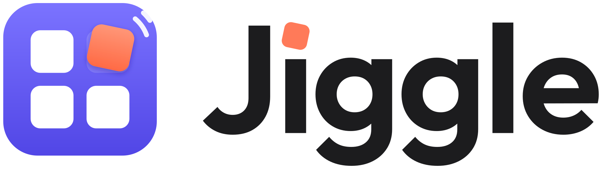

<p align="center">
  <picture>
    <source media="(prefers-color-scheme: dark)" srcset="docs/logo-dark.svg">
    
  </picture>
</p>

<p align="center">Rearrange your iPhone or iPad home screen from your Mac.</p>

Jiggle connects to an iPhone or iPad over a cable, shows a realistic preview of its home screen, and rearranges the apps in one click: alphabetically, by App Store category or by icon colour, with optional automatic folders. It is for people with hundreds of apps who find dragging icons around on the phone slow and error-prone. You always see a before/after preview, every change is backed up first, and restoring takes one click.

> **Status: early (v0.1).** Everything is built and passes its tests against mock devices, but much of it has not yet been run against real hardware. See [What is verified](#what-is-verified) before pointing it at a phone you care about. Back the phone up first.

## Features

- **Preview** the Home Screen as it is: wallpaper, pages, dock, folders and widget placeholders.
- **Apps table**: searchable and sortable by name, category, developer and location. Change an app's category (kept per Mac) or remove apps in bulk.
- **Organize**: sort by **A–Z**, **App Store category** or **icon colour**, with a before/after preview. Optional auto-folders (one folder per category, from 2 apps) and pins. Pages with widgets are kept as they are, or apps are sorted around the widgets.
- **Edit by hand**: drag and drop (or Space and arrow keys), with undo and redo, then push to the phone.
- **Send to App Library**: take apps off the Home Screen in bulk. They stay installed.
- **Saved layouts**: name the current layout ("Work", "Weekend") and switch back to it in one click.
- **Copy a layout between devices**: put the arrangement of an iPhone on an iPad, or the reverse, reflowed to the target's grid.
- **Cleanup**: remove empty pages and one-app folders.
- **Export**: PNG (one image per page), PDF (all pages) or CSV (name, bundle ID, category, developer, location).
- **History**: automatic backups before every write (the latest 50 per device are kept) and one-click restore.
- **Wi-Fi**: works over Wi-Fi once "Show this iPhone when on Wi-Fi" is on in Finder.
- **Safe by design**: validation before every write, a backup first, a read-back to verify afterwards, and read-only mode on iOS versions it does not recognise.

## Install

Releases are on the [Releases page](https://github.com/felipevlourenco/jiggle/releases). Apple silicon (arm64) only for now. Intel is planned.

Builds are signed with a free Apple Development certificate and **not notarized**, so macOS Gatekeeper blocks the first launch. Open the app once, then go to System Settings > Privacy & Security and choose **Open Anyway**. Auto-update does not install on a non-notarized build.

Requirements: macOS, and an iPhone or iPad on iOS or iPadOS 17 or later (tested on 17, 18 and 26). The phone must be unlocked and tap **Trust** the first time it is connected.

## Develop

Needs Node 24, [pnpm](https://pnpm.io) and [uv](https://docs.astral.sh/uv/) (for the Python engine).

```bash
pnpm install
cd sidecar && uv sync --python 3.12 --group dev && cd ..
pnpm dev
```

No phone at hand? Run against a mock device. The fixtures are in `tests/fixtures`:

```bash
JIGGLE_MOCK_DEVICE=iphone-widgets pnpm dev
```

| Command                                    | What it does                                                           |
| ------------------------------------------ | ---------------------------------------------------------------------- |
| `pnpm typecheck`                           | TypeScript, strict, main and renderer                                  |
| `pnpm lint`                                | ESLint                                                                 |
| `pnpm test`                                | Vitest unit and component tests                                        |
| `pnpm test:e2e`                            | Builds, then Playwright drives the real Electron app against mocks     |
| `cd sidecar && .venv/bin/python -m pytest` | Tests for the engine's RPC handlers                                    |
| `pnpm dist`                                | Builds the app. Run `bash sidecar/build.sh` first to freeze the engine |

CI (`.github/workflows/ci.yml`) runs all of these on every pull request. Pushing a `v*` tag that matches `package.json`'s version runs `release.yml`, which builds, signs and creates a **draft** GitHub release.

## How it works

```
┌─ Renderer (React) ──────────┐   typed IPC    ┌─ Main process (Node) ────────────────┐
│ screens, sheets, drag/drop  │ ◄────────────► │ ApplyService · SnapshotService       │
│ sandboxed, strict CSP       │  (zod-checked) │ CategoryService · IconService        │
└─────────────────────────────┘                │ ExportService · UninstallService     │
                                               └──────────────┬───────────────────────┘
                                                  DeviceBridge│ JSON-RPC over stdio
                                               ┌──────────────▼───────────────────────┐
                                               │ Python sidecar (pymobiledevice3)     │
                                               │ frozen with PyInstaller              │
                                               └──────────────┬───────────────────────┘
                                                              │ usbmuxd
                                                           iPhone / iPad
```

- **Electron + React + TypeScript** (strict). The renderer is sandboxed with `contextIsolation`, and every IPC channel and payload is declared once in `src/shared/ipc-contract.ts` and validated with zod.
- **Device engine** (`sidecar/`): a Python process using [pymobiledevice3](https://github.com/doronz88/pymobiledevice3), controlled over JSON-RPC. Everything goes through a `DeviceBridge` interface, so the engine can be replaced later, and a `MockBridge` serves the fixtures for dev and tests.
- **Pure layout logic** lives in `src/shared/layout`: sorting, reflow, pins, auto-folders, cleanup, diffing and validation. It has no Electron or device code, and is covered by unit tests.
- **Writes** go through `ApplyService`: validate, back up, write, read back and verify, under a per-device lock. Page capacity is checked against the grid the device reports, not a fixed table.
- **Privacy:** everything stays on your Mac. The only network request is the App Store lookup for categories (`itunes.apple.com`, one app at a time, cached on disk). Any other request from the renderer is blocked. Data lives in Electron's user data folder; logs are in `~/Library/Logs/Jiggle/`.

The full specification, with the milestones, data model and screens, is in [plan.md](plan.md).

## What is verified

All of it passes typecheck, lint, 284 unit tests, 35 engine tests and 48 end-to-end tests, run against mock devices. Not yet confirmed on real hardware:

- Writing to a phone: drag and drop, pins, auto-folders, Send to App Library, saved layouts, and uninstall.
- Wi-Fi connection.
- **iPad**: no iPad has been available. The grid (6×5), dock size and widget spans come from memory and are checked only against fixtures. Treat iPad support, and copying a layout to or from an iPad, as experimental.

Apple can change the private SpringBoard services in any iOS update. If Jiggle does not recognise the iOS version it opens read-only.

## Licence

Not decided yet. The engine uses pymobiledevice3, which is GPL-3.0-or-later, and that affects how Jiggle can be distributed (see plan.md §10).

## Brand

The icon and logo are in `build/` and `docs/`. `build/icon.icns` is generated from `build/icon.svg` (with the simplified `build/icon-small.svg` for the smallest sizes). `build/icon.png` is the Dock icon when running in dev.
